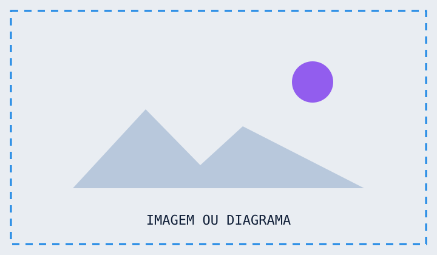

<!--
CAMPUS DEV — BOILERPLATE

Regras rápidas:
1. Troque o footer no front-matter.
2. Use _class: accent-purple / accent-orange / accent-teal para variar o destaque.
3. Prefira HTML para componentes visuais; Markdown continua ótimo para texto, listas e tabelas.
4. Para gráficos simples, use .bar-chart / .progress. O valor fica em --value.
5. Para imagens, use <div class="media"> e .
6. Duplique apenas o slide-modelo de que precisa.
7. Evite encher um slide: este boilerplate aumenta opções, não densidade.
8. Cor por componente: use c-blue / c-purple / c-orange / c-teal / c-navy em cards,
   painéis, pills e afins para variar o accent dentro do mesmo slide.
9. Compare-table: envolva a tabela em <div class="compare-table">, alinhe as
   colunas de status ao centro (:---:) e use ct-yes / ct-partial / ct-no.
-->

<!-- =========================
     01 · ABERTURA
     ========================= -->
<!-- _class: title -->

<div class="eyebrow">DISCIPLINA · AULA 01</div>

# Título da Aula
# em Duas Linhas

<p class="subtitle">Uma frase que explica por que este assunto importa.</p>

<div class="byline">
  <strong>Prof. Seu Nome</strong>
  <span>turma.exemplo · semestre 2026.1</span>
</div>

---

<!-- =========================
     02 · CARDS 4
     ========================= -->

<div class="eyebrow">VISÃO GERAL</div>

# Quatro Ideias Para Começar

<p class="subtitle">Bom para sintomas, características, princípios ou erros comuns.</p>

<div class="cards cols-4">
  <div class="card">
    <span class="n">01</span>
    <h3>Conceito</h3>
    <p>Definição curta e objetiva do primeiro ponto.</p>
  </div>
  <div class="card">
    <span class="n">02</span>
    <h3>Problema</h3>
    <p>Mostre a dor que existe antes da solução.</p>
  </div>
  <div class="card">
    <span class="n">03</span>
    <h3>Trade-off</h3>
    <p>Explique o custo ou a limitação envolvida.</p>
  </div>
  <div class="card">
    <span class="n">04</span>
    <h3>Aplicação</h3>
    <p>Feche com o que o aluno deve fazer na prática.</p>
    <span class="pill">PRÁTICA</span>
  </div>
</div>

---

<!-- =========================
     03 · CARDS 3 / VARIAÇÃO DE COR
     ========================= -->
<!-- _class: accent-purple -->

<div class="eyebrow">FUNDAMENTOS</div>

# Três Conceitos-Chave

<div class="cards cols-3">
  <div class="card">
    <span class="n">01</span>
    <h3>Entrada</h3>
    <p>O que alimenta o processo.</p>
  </div>
  <div class="card">
    <span class="n">02</span>
    <h3>Transformação</h3>
    <p>O que acontece com a informação.</p>
  </div>
  <div class="card">
    <span class="n">03</span>
    <h3>Saída</h3>
    <p>O resultado que interessa.</p>
  </div>
</div>

---

<!-- =========================
     04 · DUAS COLUNAS + CALLOUT
     ========================= -->
<!-- _class: accent-teal -->

<div class="eyebrow">CONCEITO</div>

# Problema → Conceito → Decisão

<div class="two-col">
  <div class="col">
    <span class="label">O problema</span>
    <p>Contextualize a situação em poucas frases.</p>
    <ul class="tight">
      <li>Sintoma observável.</li>
      <li>Custo ou risco.</li>
      <li>Por que a solução atual não basta.</li>
    </ul>
  </div>
  <div class="col">
    <span class="label">O conceito</span>
    <p><strong>Explique a ideia central</strong> sem transformar o slide em um capítulo de livro.</p>
    <p class="muted">Use texto curto e deixe a explicação detalhada para a fala.</p>
  </div>
</div>

<div class="callout">
  <span class="tag">NA PRÁTICA</span>
  Termine com uma regra simples de decisão ou uma situação em que o conceito deve ser usado.
</div>

---

<!-- =========================
     05 · DUAS COLUNAS ASSIMÉTRICAS
     ========================= -->

<div class="eyebrow">ANÁLISE</div>

# Contexto de um Lado, Evidência do Outro

<div class="two-col wide-left">
  <div class="col">
    <h2>Contexto</h2>
    <p>Use a coluna maior para explicar, mostrar contexto ou colocar uma imagem.</p>
    <blockquote>Uma frase-chave ou princípio que merece destaque.</blockquote>
  </div>
  <div class="col">
    <h2>Resultado</h2>
    <div class="stat">
      <span class="value">72%</span>
      <span class="caption">Indicador de exemplo</span>
      <span class="delta">↑ +8 P.P.</span>
    </div>
  </div>
</div>

---

<!-- =========================
     06 · LISTAS
     ========================= -->

<div class="eyebrow">LISTAS</div>

# Quando o Markdown É Melhor

<div class="two-col">
  <div class="col">
    <h2>Lista não ordenada</h2>
    <ul>
      <li>Definições e características.</li>
      <li>Exemplos e contraexemplos.</li>
      <li>Itens de uma revisão.</li>
      <li>Requisitos ou critérios.</li>
    </ul>
  </div>
  <div class="col">
    <h2>Lista ordenada</h2>
    <ol>
      <li>Identifique o problema.</li>
      <li>Escolha a técnica.</li>
      <li>Teste a hipótese.</li>
      <li>Meça o resultado.</li>
    </ol>
  </div>
</div>

---

<!-- =========================
     07 · CHECKLIST
     ========================= -->

<div class="eyebrow">ATIVIDADE</div>

# Checklist de Implementação

<ul class="checklist">
  <li>Entender o problema antes de abrir o editor.</li>
  <li>Definir a entrada e a saída esperadas.</li>
  <li>Escolher a estrutura ou técnica adequada.</li>
  <li>Testar pelo menos um caso normal e um caso-limite.</li>
  <li>Registrar a decisão e o motivo.</li>
</ul>

<div class="takeaway">
  <span class="label">REGRA</span>
  <p>Uma boa implementação começa por uma boa decisão.</p>
</div>

---

<!-- =========================
     08 · MÉTRICAS / KPIs
     ========================= -->

<div class="eyebrow">RESULTADOS</div>

# Três Números Para Contar a História

<div class="stats cols-3">
  <div class="stat">
    <span class="value">4.8x</span>
    <span class="caption">ganho de desempenho</span>
    <span class="delta">↑ 380%</span>
  </div>
  <div class="stat">
    <span class="value">32 ms</span>
    <span class="caption">latência média</span>
    <span class="delta">↓ 41%</span>
  </div>
  <div class="stat">
    <span class="value">91%</span>
    <span class="caption">cobertura de testes</span>
    <span class="delta">↑ 14 p.p.</span>
  </div>
</div>

<p class="muted small">Valores meramente ilustrativos. Troque pelos seus indicadores reais.</p>

---

<!-- =========================
     09 · GRÁFICO DE BARRAS
     ========================= -->

<div class="eyebrow">DADOS</div>

# Comparação Visual

<p class="subtitle">O gráfico é feito só com HTML + CSS; não depende de uma biblioteca externa.</p>

<div class="bar-chart">
  <div class="bar-row">
    <span class="name">Opção A</span>
    <div class="bar-track"><div class="bar-fill" style="--value: 82%"></div></div>
    <span class="number">82</span>
  </div>
  <div class="bar-row">
    <span class="name">Opção B</span>
    <div class="bar-track"><div class="bar-fill" style="--value: 67%"></div></div>
    <span class="number">67</span>
  </div>
  <div class="bar-row">
    <span class="name">Opção C</span>
    <div class="bar-track"><div class="bar-fill" style="--value: 54%"></div></div>
    <span class="number">54</span>
  </div>
  <div class="bar-row">
    <span class="name">Opção D</span>
    <div class="bar-track"><div class="bar-fill" style="--value: 33%"></div></div>
    <span class="number">33</span>
  </div>
</div>

---

<!-- =========================
     10 · PROGRESSO
     ========================= -->
<!-- _class: accent-purple -->

<div class="eyebrow">ACOMPANHAMENTO</div>

# Progresso de um Projeto

<div class="progress">
  <div class="meta"><span>Planejamento</span><strong>100%</strong></div>
  <div class="track"><div class="fill" style="--value:100%"></div></div>
</div>
<div class="progress">
  <div class="meta"><span>Implementação</span><strong>72%</strong></div>
  <div class="track"><div class="fill" style="--value:72%"></div></div>
</div>
<div class="progress">
  <div class="meta"><span>Testes</span><strong>44%</strong></div>
  <div class="track"><div class="fill" style="--value:44%"></div></div>
</div>
<div class="progress">
  <div class="meta"><span>Documentação</span><strong>26%</strong></div>
  <div class="track"><div class="fill" style="--value:26%"></div></div>
</div>

---

<!-- =========================
     11 · PROCESSO / FLOW
     ========================= -->

<div class="eyebrow">PROCESSO</div>

# O Fluxo em Quatro Passos

<div class="flow">
  <div class="node">
    <h3>Entrada</h3>
    <p>Dados, requisitos ou contexto.</p>
  </div>
  <div class="node">
    <h3>Tratamento</h3>
    <p>Aplicação da técnica escolhida.</p>
  </div>
  <div class="node">
    <h3>Validação</h3>
    <p>Checagem do comportamento esperado.</p>
  </div>
  <div class="node">
    <h3>Saída</h3>
    <p>Resultado observável e útil.</p>
  </div>
</div>

---

<!-- =========================
     12 · STEPS
     ========================= -->

<div class="eyebrow">MÉTODO</div>

# Como Resolver o Problema

<div class="steps cols-4">
  <div class="step">
    <span class="n">01</span>
    <h3>Entender</h3>
    <p>Defina o problema com suas próprias palavras.</p>
  </div>
  <div class="step">
    <span class="n">02</span>
    <h3>Modelar</h3>
    <p>Represente os dados e as relações importantes.</p>
  </div>
  <div class="step">
    <span class="n">03</span>
    <h3>Implementar</h3>
    <p>Converta a ideia em código ou procedimento.</p>
  </div>
  <div class="step">
    <span class="n">04</span>
    <h3>Validar</h3>
    <p>Teste, meça e revise a decisão.</p>
  </div>
</div>

---

<!-- =========================
     13 · TIMELINE
     ========================= -->

<div class="eyebrow">HISTÓRIA / ROADMAP</div>

# Linha do Tempo

<div class="timeline">
  <div class="event">
    <span class="when">FASE 01</span>
    <h3>Origem</h3>
    <p>O problema é percebido e nomeado.</p>
  </div>
  <div class="event">
    <span class="when">FASE 02</span>
    <h3>Consolidação</h3>
    <p>A técnica passa a ser usada de forma sistemática.</p>
  </div>
  <div class="event">
    <span class="when">FASE 03</span>
    <h3>Escala</h3>
    <p>O conceito amadurece e ganha novos contextos.</p>
  </div>
  <div class="event">
    <span class="when">FASE 04</span>
    <h3>Hoje</h3>
    <p>Mostre o estado atual e o que vem depois.</p>
  </div>
</div>

---

<!-- =========================
     14 · QUOTE / TESE
     ========================= -->
<!-- _class: accent-orange -->

<div class="eyebrow">TESE</div>

# Uma Ideia que Deve Ficar

<div class="quote">
  <div class="text">“A melhor escolha não é a mais sofisticada — é a que melhor atende ao problema.”</div>
  <div class="author">PRINCÍPIO DE PROJETO · EXEMPLO</div>
</div>

<div class="takeaway">
  <span class="label">PARA LEVAR</span>
  <p>Quando o aluno lembrar de apenas uma frase deste slide, deve ser esta.</p>
</div>

---

<!-- =========================
     15 · DONUT + BARRAS VERTICAIS
     ========================= -->
<!-- _class: accent-orange -->

<div class="eyebrow">GRÁFICO</div>

# Mais Duas Opções Visuais

<div class="two-col">
  <div class="col">
    <span class="label">DONUT</span>
    <div class="donut-row">
      <div class="donut" style="--percent: 68%"><span class="value">68%</span></div>
      <div>
        <h2>Percentual</h2>
        <p class="muted">Útil para composição, cobertura, participação ou progresso.</p>
      </div>
    </div>
  </div>
  <div class="col">
    <span class="label">BARRAS VERTICAIS</span>
    <div class="v-bars">
      <div class="v-bar">
        <span class="number">82</span>
        <div class="fill" style="--value:82%"></div>
        <span class="name">A</span>
      </div>
      <div class="v-bar">
        <span class="number">61</span>
        <div class="fill" style="--value:61%"></div>
        <span class="name">B</span>
      </div>
      <div class="v-bar">
        <span class="number">47</span>
        <div class="fill" style="--value:47%"></div>
        <span class="name">C</span>
      </div>
      <div class="v-bar">
        <span class="number">31</span>
        <div class="fill" style="--value:31%"></div>
        <span class="name">D</span>
      </div>
    </div>
  </div>
</div>

---

<!-- =========================
     16 · EQUAÇÃO / REGRA
     ========================= -->

<div class="eyebrow">FÓRMULA</div>

# Uma Regra Pode Caber em Um Bloco

<div class="equation">resultado = entrada × estratégia − custo</div>

<div class="two-col">
  <div class="col">
    <h2>Como ler</h2>
    <ul>
      <li><span class="kicker">entrada</span>: informação disponível.</li>
      <li><span class="kicker">estratégia</span>: decisão tomada.</li>
      <li><span class="kicker">custo</span>: preço pago pela escolha.</li>
    </ul>
  </div>
  <div class="col">
    <h2>Quando usar</h2>
    <p class="muted">Ótimo para fórmulas, heurísticas, relações, regras de negócio e ideias que precisam de leitura imediata.</p>
  </div>
</div>

---

<!-- =========================
     17 · AVISOS / ALERTAS
     ========================= -->

<div class="eyebrow">ATENÇÃO</div>

# Quatro Tipos de Destaque

<div class="two-col">
  <div class="col">
    <div class="notice">
      <span class="notice-title">NOTA</span>
      Informação complementar que ajuda a entender o conceito.
    </div>
    <div class="notice success">
      <span class="notice-title">BOA PRÁTICA</span>
      Algo que merece ser repetido ou adotado.
    </div>
  </div>
  <div class="col">
    <div class="notice warning">
      <span class="notice-title">CUIDADO</span>
      Condição ou detalhe que costuma causar erro.
    </div>
    <div class="notice danger">
      <span class="notice-title">RISCO</span>
      Algo que pode comprometer a solução ou o resultado.
    </div>
  </div>
</div>

---

<!-- =========================
     18 · TABELA
     ========================= -->

<div class="eyebrow">COMPARAÇÃO</div>

# Tabela Comparativa

<p class="subtitle">Ideal para diferenças objetivas entre conceitos, ferramentas ou estratégias.</p>

| Opção | Custo | Escala | Complexidade | Quando usar |
|---|---:|---:|---:|---|
| A | Baixo | Média | Baixa | Cenários simples |
| B | Médio | Alta | Média | Cenários recorrentes |
| C | Alto | Muito alta | Alta | Cenários críticos |
| D | Médio | Alta | Baixa | Protótipos |

<div class="callout">
  <span class="tag">LEITURA</span>
  Use a tabela para comparar; use o texto para explicar a conclusão.
</div>

---

<!-- =========================
     19 · DECISION MATRIX
     ========================= -->
<!-- _class: accent-teal -->

<div class="eyebrow">DECISÃO</div>

# Qual Caminho Escolher?

<div class="decision-grid">
  <div class="head">Critério</div>
  <div class="head">A</div>
  <div class="head">B</div>
  <div class="head">C</div>

  <div>Baixa latência</div>
  <div class="yes">✓</div>
  <div class="yes">✓</div>
  <div class="no">—</div>

  <div>Baixo custo</div>
  <div class="yes">✓</div>
  <div class="no">—</div>
  <div class="yes">✓</div>

  <div>Fácil manutenção</div>
  <div class="yes">✓</div>
  <div class="yes">✓</div>
  <div class="no">—</div>

  <div>Alta flexibilidade</div>
  <div class="no">—</div>
  <div class="yes">✓</div>
  <div class="yes">✓</div>
</div>

---

<!-- =========================
     20 · CÓDIGO
     ========================= -->

<div class="eyebrow">CÓDIGO</div>

# Exemplo Técnico

<div class="two-col">
  <div class="col">
    <span class="label">Implementação</span>

```python
def buscar_aluno(alunos, matricula):
    for aluno in alunos:
        if aluno["matricula"] == matricula:
            return aluno
    return None
```

  </div>
  <div class="col">
    <span class="label">Leitura</span>
    <ul>
      <li>A solução percorre a coleção.</li>
      <li>No pior caso, visita todos os elementos.</li>
      <li>Complexidade: <code>O(n)</code>.</li>
    </ul>
    <div class="callout">
      <span class="tag">PERGUNTA</span>
      O que precisaria mudar para tornar a busca mais eficiente?
    </div>
  </div>
</div>

---

<!-- =========================
     21 · IMAGEM / MEDIA
     ========================= -->

<div class="eyebrow">VISUAL</div>

# Imagem com Contexto

<div class="two-col">
  <div class="media">
    
    <div class="caption">Legenda curta explicando o que o aluno deve observar.</div>
  </div>
  <div class="col">
    <h2>O que observar</h2>
    <ol class="tight">
      <li>Primeiro elemento relevante.</li>
      <li>Relação entre os elementos.</li>
      <li>Conclusão ou implicação.</li>
    </ol>
  </div>
</div>

---

<!-- =========================
     22 · IMAGEM EM CARD
     ========================= -->

<div class="eyebrow">EXEMPLOS</div>

# Galeria de Três Conceitos

<div class="cards cols-3">
  <div class="image-card">
    
    <h3>Exemplo A</h3>
    <p>Descrição curta do primeiro elemento.</p>
  </div>
  <div class="image-card">
    
    <h3>Exemplo B</h3>
    <p>Descrição curta do segundo elemento.</p>
  </div>
  <div class="image-card">
    
    <h3>Exemplo C</h3>
    <p>Descrição curta do terceiro elemento.</p>
  </div>
</div>

---

<!-- =========================
     23 · FONTES
     ========================= -->

<div class="eyebrow">REFERÊNCIAS</div>

# Fontes e Leituras

<ol class="sources">
  <li>Autor, A. <em>Título do livro ou artigo</em>. Editora / periódico, 2026.</li>
  <li>Organização. <em>Documentação oficial</em>. URL ou DOI.</li>
  <li>Material institucional da disciplina.</li>
</ol>

<div class="source">
  <strong>Fonte principal:</strong> substitua este bloco por URL, DOI, livro, capítulo ou observação metodológica.
</div>

---

<!-- =========================
     24 · ABERTURA CLARA (variante do slide 1 do modelo)
     ========================= -->
<!-- _class: title light -->

<div class="eyebrow">WORKSHOP · TEMA DA SESSÃO</div>

# Título de Impacto
# em Duas Linhas

<p class="subtitle">Uma frase em itálico mono que resume a tese da apresentação.</p>

<div class="byline">
  <strong>Prof. Seu Nome</strong>
  <span>cargo · instituição</span>
</div>

---

<!-- =========================
     25 · DIVISOR DE SEÇÃO
     ========================= -->
<!-- _class: section-divider -->

<div class="part">PARTE 02 / 03</div>

# Os 7 Tópicos

<div class="topic-list">
  <div class="topic"><span class="n">01</span><span>Primeiro tópico</span></div>
  <div class="topic"><span class="n">02</span><span>Segundo tópico</span></div>
  <div class="topic"><span class="n">03</span><span>Terceiro tópico</span></div>
  <div class="topic"><span class="n">04</span><span>Quarto tópico</span></div>
  <div class="topic"><span class="n">05</span><span>Quinto tópico</span></div>
  <div class="topic"><span class="n">06</span><span>Sexto tópico</span></div>
  <div class="topic"><span class="n">07</span><span>Sétimo tópico<br>em duas linhas</span></div>
  <div class="topic"><span>bônus: extra</span></div>
</div>

---

<!-- =========================
     26 · CARDS MULTICOLOR + PILLS ARREDONDADAS
     ========================= -->

<div class="eyebrow">ESPECTRO</div>

# Cada Card Com Sua Cor

<p class="subtitle">A cor segue o card, não o slide: use c-orange / c-purple / c-blue / c-teal / c-navy.</p>

<div class="cards cols-4">
  <div class="card c-orange">
    <span class="n">01</span>
    <h3>Nível um</h3>
    <p>Estado inicial ou pior cenário.</p>
    <span class="pill rounded">RISCO</span>
  </div>
  <div class="card c-purple">
    <span class="n">02</span>
    <h3>Nível dois</h3>
    <p>Melhora parcial, ainda com custo.</p>
    <span class="pill rounded">GARGALO</span>
  </div>
  <div class="card c-blue">
    <span class="n">03</span>
    <h3>Nível três</h3>
    <p>Prática recomendada do momento.</p>
    <span class="pill rounded">QUALIDADE</span>
  </div>
  <div class="card c-teal">
    <span class="n">04</span>
    <h3>Nível quatro</h3>
    <p>Estado da arte ou meta de evolução.</p>
    <span class="pill rounded">DIFERENCIAL</span>
  </div>
</div>

<div class="callout">
  "Uma citação curta que sintetiza o slide inteiro e fecha o raciocínio."
  <span class="attrib">— AUTOR · FONTE</span>
</div>

---

<!-- =========================
     27 · PIPELINE OUTLINE
     ========================= -->
<!-- _class: accent-teal -->

<div class="eyebrow">O FLUXO</div>

# Caixas com Borda, Ligadas por Setas

<div class="flow outline">
  <div class="node"><h3>Specify</h3></div>
  <div class="node"><h3>Design</h3></div>
  <div class="node"><h3>Tasks</h3></div>
  <div class="node"><h3>Execute</h3></div>
</div>

<ul class="list dash">
  <li><strong>A spec</strong> é o gabarito do design.</li>
  <li><strong>O design</strong> é o gabarito das tarefas.</li>
  <li><strong>As tarefas</strong>, com critérios de aceite, são o gabarito da execução.</li>
</ul>

<div class="callout">
  <span class="tag">NA PRÁTICA</span>
  Cada fase produz um artefato que vira o contrato da próxima. Etapas triviais podem ser puladas.
</div>

---

<!-- =========================
     28 · CASCATA
     ========================= -->

<div class="eyebrow">A CASCATA</div>

# Validação em Camadas Ordenadas

<div class="two-col wide-left">
  <div class="col">
    <div class="cascade">
      <div class="cascade-step">
        <span class="c-name">Validação estrutural</span>
        <span class="c-desc">lint · testes · typecheck</span>
      </div>
      <div class="cascade-step">
        <span class="c-name">Integridade</span>
        <span class="c-desc">não destruiu o que é crítico?</span>
      </div>
      <div class="cascade-step">
        <span class="c-name">Suficiência</span>
        <span class="c-desc">mudou o que foi pedido?</span>
      </div>
      <div class="cascade-step">
        <span class="c-name">Similaridade</span>
        <span class="c-desc">"parece" com o esperado?</span>
      </div>
      <div class="cascade-step">
        <span class="c-name">Revisão final</span>
        <span class="c-desc">cumpre o critério de aceite?</span>
      </div>
      <div class="cascade-result">TAREFA ACEITA</div>
    </div>
  </div>
  <div class="col">
    <span class="label">POR QUE EM CASCATA</span>
    <p>Cada etapa é <strong>mais cara e mais profunda</strong> que a anterior.</p>
    <p class="muted">O que falha na primeira camada não chega na última — economiza tempo e custo. Quando algo falha, o motivo volta classificado e com sugestão acionável.</p>
  </div>
</div>

---

<!-- =========================
     29 · PAINÉIS DE CONTEXTO
     ========================= -->

<div class="eyebrow">TRADE-OFFS</div>

# Dois Painéis, Dois Tons

<p class="subtitle">Borda esquerda grossa + fundo tintado. Bom para risco × posição, antes × depois, prós × contras.</p>

<div class="two-col">
  <div class="panel c-orange">
    <span class="label">POR QUE IMPORTA</span>
    <p>Contexto de risco ou atenção. Explique em duas ou três frases curtas o que pode dar errado e por que isso é relevante agora.</p>
    <p>Um segundo parágrafo com a consequência prática de ignorar o risco.</p>
  </div>
  <div class="panel c-teal">
    <span class="label">POSIÇÃO HONESTA</span>
    <p>Contexto positivo ou posição defendida. Diga o que é verdade hoje, sem exagerar na promessa.</p>
    <p>Um segundo parágrafo com o caminho realista de evolução.</p>
  </div>
</div>

---

<!-- =========================
     30 · CARDS TINTADOS
     ========================= -->
<!-- _class: accent-orange -->

<div class="eyebrow">LIMITES</div>

# Cards com Fundo na Cor do Accent

<p class="subtitle">Use .card.tint junto com a utilidade de cor. O slide pode ter um accent e os cards, outro.</p>

<div class="cards cols-3">
  <div class="card tint c-teal">
    <h3>Primeiro limite</h3>
    <p>O que o sistema não pode fazer sob nenhuma hipótese, com um exemplo curto de violação clássica.</p>
  </div>
  <div class="card tint c-teal">
    <h3>Segundo limite</h3>
    <p>Proporcionalidade: o resultado tem que ser compatível com o tamanho do pedido.</p>
  </div>
  <div class="card tint c-teal">
    <h3>Terceiro limite</h3>
    <p>Orçamento explícito: esgotou, para. Sem limite, o sistema entra em loop silencioso.</p>
  </div>
</div>

<div class="callout">
  <span class="tag">NA PRÁTICA</span>
  Cada limite vem habilitado por padrão, com regras sensatas. Você afina por projeto, não precisa lembrar de ligar.
</div>

---

<!-- =========================
     31 · SLOT DE MÍDIA / VÍDEO
     ========================= -->

<div class="eyebrow">DEMONSTRAÇÃO</div>

# Conceito de um Lado, Mídia do Outro

<div class="two-col">
  <div class="col">
    <span class="label">O CONCEITO</span>
    <p><strong>Termo um</strong> = definição curta e direta do primeiro conceito, com uma frase de exemplo.</p>
    <p><strong>Termo dois</strong> = definição do segundo conceito e como ele se relaciona com o primeiro.</p>
  </div>
  <div class="col">
    <span class="label">VÍDEO 01 — TÍTULO · 15–25s</span>
    <div class="media-slot">
      <span class="play">▶</span>
      <span>placeholder de vídeo<br>ou substitua por &lt;img&gt;</span>
    </div>
  </div>
</div>

<div class="callout">
  <span class="tag">NA PRÁTICA</span>
  O slot marca onde a mídia entra na hora da apresentação; em PDF, vira uma moldura com o rótulo.
</div>

---

<!-- =========================
     32 · LISTAS DASH E ARROW
     ========================= -->

<div class="eyebrow">MECANISMOS</div>

# Marcadores do Modelo Original

<div class="two-col">
  <div class="col">
    <h2>Dash (—)</h2>
    <ul class="list dash">
      <li><strong>Item um</strong> — explicação curta do mecanismo.</li>
      <li><strong>Item dois</strong> — o que ele detecta ou evita.</li>
      <li><strong>Item três</strong> — quando ele dispara.</li>
      <li><strong>Item quatro</strong> — como é configurado.</li>
    </ul>
  </div>
  <div class="col">
    <h2>Arrow (→)</h2>
    <ul class="list arrow">
      <li>Entrada bruta → dado tratado.</li>
      <li>Sinal fraco → ação concreta.</li>
      <li>Erro recorrente → regra permanente.</li>
    </ul>
  </div>
</div>

---

<!-- =========================
     33 · COMPARE TABLE (✓ / ~ / ✗ + coluna destaque)
     ========================= -->

<div class="eyebrow">COMPARAÇÃO</div>

# A Tabela Completa

<p class="subtitle">Colunas de status alinhadas no markdown (:---:) + destaque via _style. Use spans para semântica de ✓, ~ e ✗.</p>

<!-- _style: ".compare-table td:nth-child(2), .compare-table th:nth-child(2) { background: var(--purple-tint); } .compare-table th:nth-child(2) { background: var(--purple); }" -->

<div class="compare-table">

| Critério | Nós | Opção A | Opção B | Opção C |
|---|:---:|:---:|:---:|:---:|
| 1 · Método estruturado | <span class="ct-yes">✓</span> | <span class="ct-no">✗</span> | <span class="ct-no">✗</span> | <span class="ct-partial">~</span> |
| 2 · Coordenação | <span class="ct-yes">✓</span> | <span class="ct-yes">✓</span> | <span class="ct-partial">~</span> | <span class="ct-partial">~</span> |
| 3 · Verificação | <span class="ct-yes">✓</span> | <span class="ct-partial">~</span> | <span class="ct-no">✗</span> | <span class="ct-no">✗</span> |
| 4 · Limites de segurança | <span class="ct-yes">✓</span> | <span class="ct-yes">✓</span> | <span class="ct-partial">~</span> | <span class="ct-no">✗</span> |
| 5 · Resiliência | <span class="ct-yes">✓</span> | <span class="ct-partial">~</span> | <span class="ct-partial">~</span> | <span class="ct-partial">~</span> |
| 6 · Observabilidade | <span class="ct-yes">✓</span> | <span class="ct-yes">✓</span> | <span class="ct-no">✗</span> | <span class="ct-partial">~</span> |

</div>

<div class="callout">
  <span class="tag">LEITURA</span>
  Destaque a coluna que você defende e use o callout para a conclusão, não para repetir a tabela.
</div>

---

<!-- =========================
     34 · ESPECTRO
     ========================= -->

<div class="eyebrow">MATURIDADE</div>

# Onde Você Está Nesse Espectro?

<div class="cards cols-4 no-stretch">
  <div class="card c-orange">
    <h3>Nenhum</h3>
    <p>Processo totalmente manual, sem nenhum apoio.</p>
  </div>
  <div class="card c-purple">
    <h3>Básico</h3>
    <p>Ferramenta padrão, sem configuração.</p>
  </div>
  <div class="card c-blue">
    <h3>Controlado</h3>
    <p>Regras e limites definidos por projeto.</p>
  </div>
  <div class="card c-teal">
    <h3>Estado da arte</h3>
    <p>Isolamento total e melhoria contínua.</p>
  </div>
</div>

<div class="spectrum-labels">
  <span>← pior</span>
  <span>estado da arte →</span>
</div>

<p class="muted small" style="margin-top: 26px;">Dica: no espectro, a cor do card faz o trabalho de posicionar cada nível — a legenda só reforça a direção de leitura.</p>

---

<!-- =========================
     35 · QR CARD / CONTATO
     ========================= -->

<div class="eyebrow">SOBRE MIM</div>

# Seu Nome

<div class="two-col wide-left">
  <div class="col">
    <ul class="list dash">
      <li>Cargo atual @ Empresa.</li>
      <li>Credencial ou comunidade relevante.</li>
      <li>Projeto ou papel que conecta com a aula.</li>
      <li>Mentoria, pesquisa ou atividade extra.</li>
    </ul>
  </div>
  <div class="col">
    <div class="qr-card">
      
      <div class="qr-label">LINKEDIN</div>
      <a class="qr-link" href="#">linkedin.com/in/seuperfil</a>
    </div>
  </div>
</div>

---

<!-- =========================
     36 · LOGO SLOT
     ========================= -->


<div class="eyebrow">IDENTIDADE</div>

# Logo Fixo no Canto Superior Direito

<p class="subtitle">Troque o src por uma imagem em slides/assets/. O slot fica absoluto e não interfere no conteúdo.</p>

<div class="cards cols-3">
  <div class="card">
    <span class="n">01</span>
    <h3>Posição fixa</h3>
    <p>O logo fica sempre no mesmo canto, independente do layout do slide.</p>
  </div>
  <div class="card">
    <span class="n">02</span>
    <h3>Tamanho contido</h3>
    <p>44px de largura por padrão. Ajuste com uma regra inline se precisar.</p>
  </div>
  <div class="card">
    <span class="n">03</span>
    <h3>Opcional</h3>
    <p>Sem o elemento <span class="inline-code">&lt;img class="brand-logo"&gt;</span>, nada muda.</p>
  </div>
</div>

---

<!-- =========================
     37 · CARDS COM ÍCONE
     ========================= -->

<div class="eyebrow">CONCEITOS</div>

# Cards com Ícone Grande

<div class="cards cols-3">
  <div class="card">
    <span class="icon-lg">⚙️</span>
    <h3>Configuração</h3>
    <p>Use emoji ou um caractere unicode como ícone rápido, sem depender de biblioteca de ícones.</p>
  </div>
  <div class="card c-purple">
    <span class="icon-lg">🧪</span>
    <h3>Experimento</h3>
    <p>Combine com a utilidade de cor para reforçar a categoria do conceito.</p>
  </div>
  <div class="card c-teal">
    <span class="icon-lg">📈</span>
    <h3>Resultado</h3>
    <p>Bom para listas de ferramentas, etapas de método ou pilares de um tema.</p>
  </div>
</div>

---

<!-- =========================
     38 · FECHAMENTO
     ========================= -->
<!-- _class: title -->

<div class="eyebrow">RESUMO</div>

# A Ideia Central
# em Uma Frase.

<p class="subtitle">Próxima aula: conecte este conceito ao próximo tópico do curso.</p>

<div class="byline">
  <strong>Prof. Seu Nome</strong>
  <span>material em: link.do.seu.repo</span>
</div>
